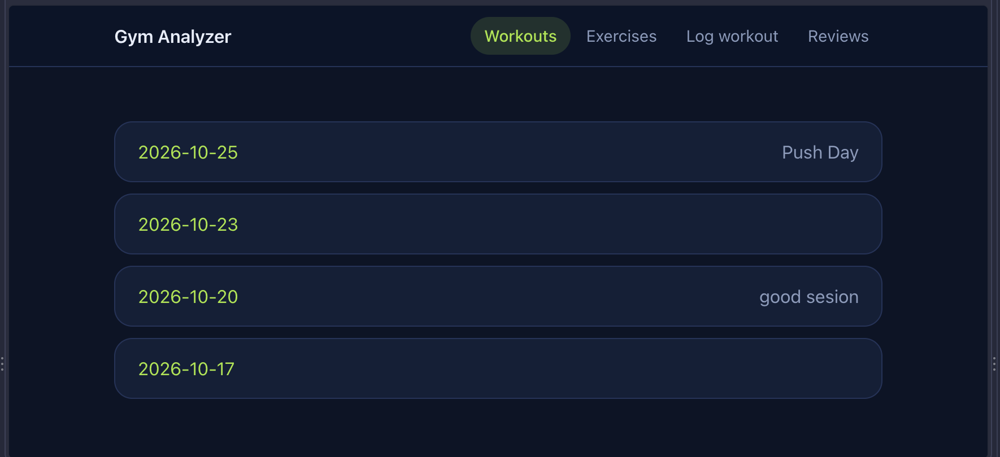
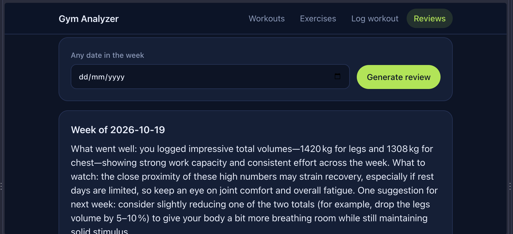

# Gym Analyzer

A web app where I log my workouts and get a weekly AI review of my sessions.




## Features

- **Log workouts** with any number of exercises and any number of sets. Each set has its own reps and weight.
- **SQL stats**: weekly volume, estimated 1RM (Epley formula), and week-over-week change.
- **AI weekly review** written by an LLM through the Groq API. Each review is stored in the database, so the API is called only once per week.
- **Weekly automation**: the `flask generate-review` command creates the review for the last full week and can be scheduled with cron.

## Tech stack

- Python 3.12, Flask, Jinja2 templates
- SQLite via the standard `sqlite3` module, with raw SQL and no ORM
- Groq API for the weekly review
- pytest for tests

## Setup

```bash
git clone <gym-analyzer> gym-analyzer
cd gym-analyzer
python3.12 -m venv venv
source venv/bin/activate
pip install -r requirements.txt
cp .env.example .env
```

Open `.env` and replace `your-key-here` with your own Groq API key (create one at console.groq.com). Never commit `.env`; it is listed in `.gitignore`.

Create the database and start the app:

```bash
python init_db.py
flask run
```

Open http://127.0.0.1:5000. Add a few exercises first, then log a workout.

Optional: `python sample_data.py` builds `sample.db` with a few example workouts. It is used for experiments and does not touch `gym.db`.

## Run the tests

```bash
pytest
```

The tests use an in-memory SQLite database and a fake Groq client, so they need no API key and no network.

## How it works

| File                    | Job                                                                      |
| ----------------------- | ------------------------------------------------------------------------ |
| `app.py`                | Flask routes, form parsing and validation, the `generate-review` command |
| `db.py`                 | All reads and writes to SQLite (parameterized SQL only)                  |
| `schema.sql`            | Tables, constraints and indexes                                          |
| `stats.py`              | The analytics queries (volume, 1RM, weekly change)                       |
| `review.py`             | Builds the prompt, calls Groq, stores and reads reviews                  |
| `init_db.py`            | Creates `gym.db` from `schema.sql`                                       |
| `templates/`, `static/` | Pages and the stylesheet                                                 |
| `tests/`                | pytest suite                                                             |

Flow: the browser sends a form to a Flask route, the route validates the input, `db.py` saves it, and `stats.py` reads it back. `review.py` sends the weekly stats to Groq and saves the answer.

## Design decisions

- **Raw SQL instead of an ORM.** I built this project to practice the SQL I learned in the Kaggle "Intro to SQL" course, so the analytics are written as plain queries.
- **Constraints in the database.** Foreign keys and `UNIQUE` rules protect the data even if the app code has a bug. Exercise names are unique regardless of upper or lower case.
- **Validation on the server.** The browser checks the form for convenience, but `parse_workout` in `app.py` is the real check.
- **One transaction per workout.** A workout and all of its sets are saved together or not at all.
- **Reviews are stored.** A `UNIQUE` week start date means each week is generated once. Reloading the page never spends API calls.
- **The Groq client is passed into `generate_review`.** Tests give it a fake client, so no test touches the network.
- **Weeks start on Monday.** The review always covers the last full Monday to Sunday.

## Weekly automation

`flask generate-review` creates (or reuses) the AI review for the last full Mon-Sun week.

### macOS / Linux (cron)

Run `crontab -e` and add (Mondays at 08:00):

    0 8 * * 1 cd /path/to/gym-analyzer && /path/to/gym-analyzer/venv/bin/flask generate-review >> review.log 2>&1

cron starts with an empty environment and the wrong folder, so the line must
`cd` into the project (the database path is relative) and call the venv's
`flask` by full path. If the Mac is asleep at 08:00, the job is skipped.

### Windows (Task Scheduler)

Create a basic task, trigger Weekly on Monday 08:00, action "Start a program":

- Program: `C:\path\to\gym-analyzer\venv\Scripts\flask.exe`
- Arguments: `generate-review`
- Start in: `C:\path\to\gym-analyzer`

## What I would add next

- Progress charts for weekly volume and estimated 1RM
- Edit and delete workouts
- Retry with backoff when the Groq API is busy
